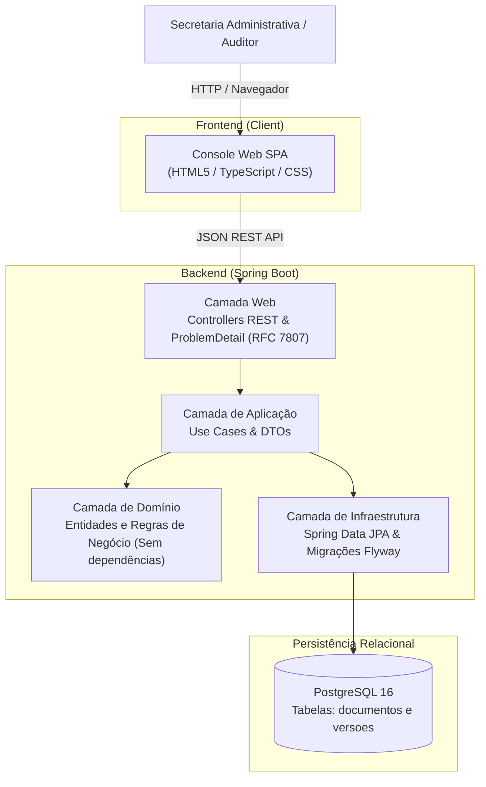

# Arquivo Digital da ONG (ONG-AD)

[](https://github.com/gixweb/ONG-AD/releases)
[](https://github.com/gixweb/ONG-AD/actions)
[](https://github.com/gixweb/ONG-AD)
[](LICENSE)
[](https://www.oracle.com/java/)
[](https://spring.io/projects/spring-boot)

> **Arquivo Digital da ONG** — Atividade Prática de Engenharia de Software, Gestão de Backlog e SDLC.

---

## 1. Problema e Solução

### O Problema
Em organizações não governamentais, documentos regulatórios essenciais (como atas de assembleia, contratos de convênios, relatórios financeiros e ofícios institucionais) costumam ficar dispersos entre e-mails, computadores locais e mídias físicas (*pen drives*). Quando a organização é submetida a **auditorias fiscais e prestações de contas**, a equipe enfrenta enorme morosidade e incerteza para determinar qual é a versão vigente e oficial de cada documento.

### A Solução
O **Arquivo Digital da ONG** é uma aplicação web e API RESTful que centraliza o acervo documental:
* Registra metadados e garante início padronizado na versão 1 com status `vigente`.
* Controla alterações por **versionamento atômico incremental**, preservando o histórico de todas as revisões anteriores e a justificativa de alteração.
* Permite **arquivar documentos obsoletos ou finalizados**, bloqueando permanentemente qualquer tentativa de alteração ou nova versão (HTTP 409 Conflict).
* Oferece **busca multicritério** veloz por tipo de documento, período de datas e parte do título.

---

## 2. Status das Funcionalidades

| Identificador | Funcionalidade | Status | Fase |
| :--- | :--- | :--- | :--- |
| **RF01** | Registrar documento (título, tipo, data, responsável) com versão 1 e status vigente | 🟡 Planejado | Fase 2 (`v0.3.0`) |
| **CA1** | Rejeição de tipos não permitidos (ex: memorando) com HTTP 400 | 🟡 Planejado | Fase 2 (`v0.3.0`) |
| **RF02 / CA4** | Buscar por tipo, período (`data_inicio` a `data_fim`) e parte do título | 🟡 Planejado | Fase 2 (`v0.3.0`) |
| **RF03 / CA2** | Registrar nova versão incrementando `versao_atual` e mantendo histórico | 🟡 Planejado | Fase 2 (`v0.3.0`) |
| **RF04 / CA3** | Arquivar documento com bloqueio estrito contra novas versões (HTTP 409) | 🟡 Planejado | Fase 2 (`v0.3.0`) |
| **RF05** | Consultar histórico completo de versões de um documento | 🟡 Planejado | Fase 2 (`v0.3.0`) |
| **RF06** | Painel e endpoint de métricas consolidadas do arquivo | 🟡 Planejado | Fase 3 (`v0.4.0`) |
| **UI** | Console Web SPA (folder-split em `frontend/`) consumindo a API REST | 🟡 Planejado | Fase 3 (`v0.4.0`) |
| **SDLC** | Especificação, 15 Issues no GitHub, Git Flow e Quality Gates | 🟢 **Implementado** | Fase 0 (`v0.1.0`) |

---

## 3. Arquitetura e Contrato REST

### 3.1 Diagrama de Contêineres (C4-Lite)



### 3.2 Tabela de Endpoints REST (`/api/v1`)

| Método | Endpoint | Descrição | Códigos de Retorno |
| :--- | :--- | :--- | :--- |
| `POST` | `/api/v1/documentos` | Cadastra novo documento na versão 1 | `201 Created`, `400 Bad Request` |
| `GET` | `/api/v1/documentos` | Lista documentos com filtros (tipo, período, título) | `200 OK` |
| `GET` | `/api/v1/documentos/{id}` | Recupera documento e versão vigente por ID | `200 OK`, `404 Not Found` |
| `POST` | `/api/v1/documentos/{id}/versoes` | Cria nova versão incremental com histórico | `200 OK`, `400 Bad Request`, `404 Not Found`, `409 Conflict` |
| `PATCH`| `/api/v1/documentos/{id}/arquivar`| Arquiva documento bloqueando alterações | `200 OK`, `404 Not Found` |
| `GET` | `/api/v1/documentos/{id}/versoes` | Consulta histórico completo de versões | `200 OK`, `404 Not Found` |
| `GET` | `/api/v1/metricas` | Resumo consolidado de contagens | `200 OK` |

---

## 4. Estrutura do Repositório (Folder-Split)

```text
ONG-AD/
├── .github/
│   ├── issue-templates/           # Templates de Issues para o GitHub
│   └── workflows/
│       └── ci.yml                 # Pipeline GitHub Actions (Build, Test, JaCoCo)
├── docs/                          # Documentação técnica obrigatória (pt-BR)
│   ├── project-charter.md         # Termo de Abertura e Metas SMART
│   ├── requisitos.md              # RF01-RF06, RNF01-RNF07 e Matriz de Rastreabilidade
│   ├── casos-de-uso.md            # Atores, fluxos principais, alternativos e exceções
│   ├── user-stories.md            # Histórias BDD/Gherkin (US01-US06)
│   ├── backlog-issues.sh          # Script de automação das 15 issues via GitHub CLI
│   ├── backlog-issues.ps1         # Script PowerShell para execução no Windows
│   └── adr/                       # Architectural Decision Records
│       ├── 001-stack-e-banco-postgresql.md
│       └── 002-estrategia-versionamento-documental.md
├── backend/                       # Aplicação Spring Boot (Java 21)
│   ├── pom.xml
│   ├── mvnw / mvnw.cmd
│   └── src/
│       ├── main/java/com/ong/backend/...
│       └── test/java/com/ong/backend/...
├── frontend/                      # Console Web independente (SPA)
│   └── .gitkeep
├── .env.example                   # Exemplo de configuração de variáveis de ambiente
├── .gitignore                     # Filtros para Java, Maven, Frontend e IDEs
└── README.md                      # Documentação central do repositório
```

---

## 5. Documentação do Projeto (`docs/`)

Acesse a documentação formal e rastreável nos links diretos abaixo:

1. [Termo de Abertura (Project Charter)](docs/project-charter.md) — Visão, objetivos SMART, escopo e partes interessadas.
2. [Especificação de Requisitos](docs/requisitos.md) — Requisitos funcionais (RF01-RF06), não-funcionais (RNF01-RNF07) e critérios CA1 a CA4.
3. [Especificação de Casos de Uso](docs/casos-de-uso.md) — Fluxos detalhados e cenários de exceção para cada caso de uso.
4. [Histórias de Usuário (User Stories)](docs/user-stories.md) — Critérios de aceite em formato BDD/Gherkin (Dado/Quando/Então).
5. [ADR 001: Persistência em PostgreSQL](docs/adr/001-stack-e-banco-postgresql.md) — Justificativa da stack e integridade ACID.
6. [ADR 002: Versionamento e Arquivamento](docs/adr/002-estrategia-versionamento-documental.md) — Invariantes de domínio e bloqueio 409.

---

## 6. Instruções de Configuração e Execução

### 6.1 Pré-requisitos
* **Java Development Kit (JDK):** Versão 21 ou superior instalada.
* **Maven:** Incluso via wrapper (`./mvnw` ou `mvnw.cmd`).
* **PostgreSQL:** Versão 16 (ou container Docker equivalente). Para execução rápida de testes, o perfil de teste utiliza banco H2 em memória.

### 6.2 Executando o Backend
```bash
# 1. Navegue até o diretório do backend
cd backend

# 2. Compile e execute os testes automatizados
./mvnw clean test

# 3. Inicie o servidor da aplicação
./mvnw spring-boot:run
```
A API estará acessível em: `http://localhost:8080`.

---

## 7. Fluxo de Trabalho de Engenharia (Git Flow)

Adotamos o modelo de **Git Flow** com branches temáticas associadas às issues do GitHub:

| Branch | Finalidade | Origem | Merge para |
| :--- | :--- | :--- | :--- |
| `main` | Código de produção, estável e com tags de versão anotadas | — | — |
| `develop` | Branch de integração de novas funcionalidades | `main` | `main` (via PR) |
| `feature/issue-XX-slug` | Implementação de funcionalidade específica | `develop` | `develop` (via PR) |
| `docs/issue-XX-slug` | Criação e manutenção de documentação | `develop` | `develop` (via PR) |
| `chore/issue-XX-slug` | Configurações, dependências e tarefas de tooling | `develop` | `develop` (via PR) |

### Padrão de Commits Atômicos (Conventional Commits)
* `feat(documento): cadastrar novo documento com versao 1 (#10)`
* `docs(requisitos): documentar critérios CA1 a CA4 (#3)`
* `test(versao): cobrir bloqueio de versionamento em documento arquivado (#11)`
* `chore(ci): configurar pipeline do github actions (#7)`

---

## 8. Licença
Este projeto está sob a licença [MIT](LICENSE).
