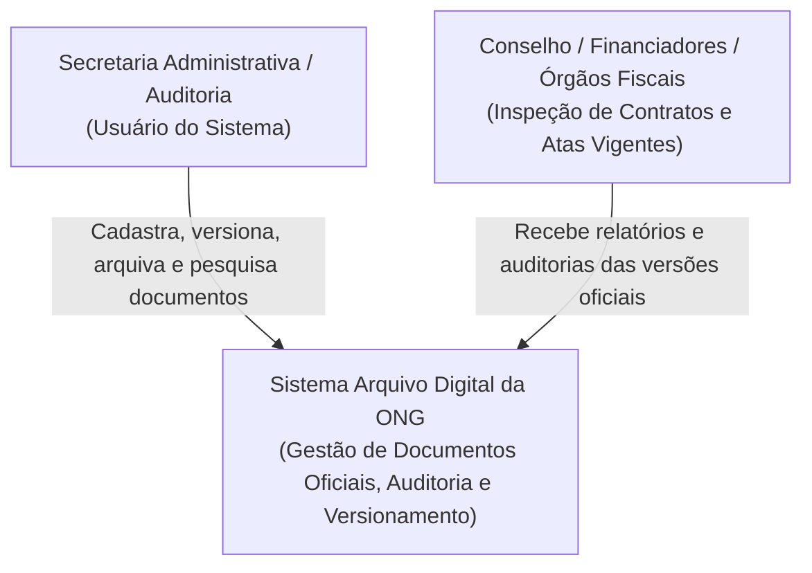
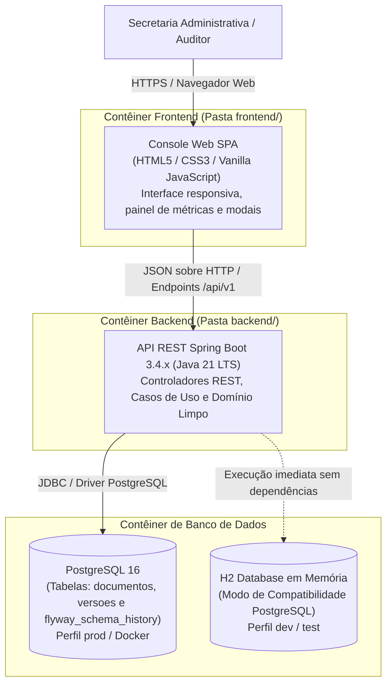
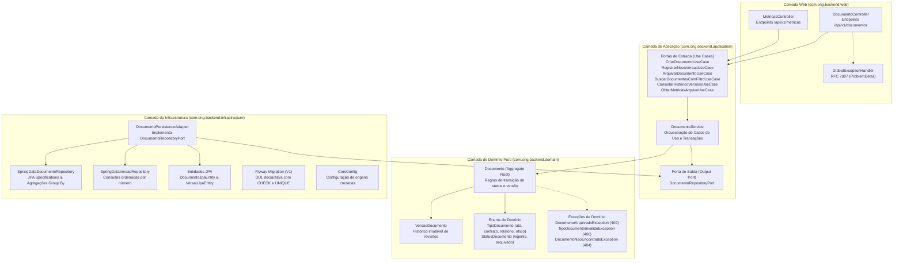
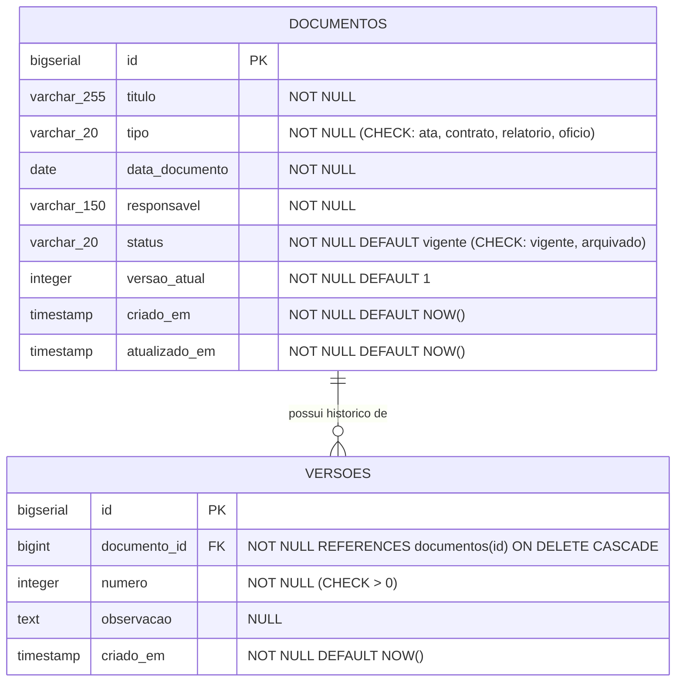

# Documento de Arquitetura de Software (DAS)
## Arquivo Digital da ONG — Desafio 14

---

## 1. Visão Geral e Princípios Arquiteturais

O **Arquivo Digital da ONG** é projetado sob os fundamentos da **Arquitetura Limpa (Clean Architecture)** e **Arquitetura Hexagonal (Ports & Adapters)**, combinada com uma estratégia de divisão estrita de pastas (**folder-split**) entre cliente web e servidor de aplicação.

### 1.1 Princípios Norteadores
* **Independência de Frameworks (Inversão de Dependência):** A camada de domínio é escrita em **Java 21 puro**, sem nenhuma anotação ou dependência de Spring Boot ou Jakarta Persistence (JPA).
* **Alta Coesão e Baixo Acoplamento:** As regras de negócio centrais (validação de tipos homologados, incremento atômico de versão e bloqueio estrito contra alterações em documentos arquivados) residem exclusivamente no agregado de domínio.
* **Integridade Transacional (ACID):** O versionamento documental sincroniza atomicamente as tabelas `documentos` e `versoes` sob o isolamento `READ_COMMITTED` e restrição relacional de unicidade `UNIQUE(documento_id, numero)`.
* **Padronização RESTful e RFC 7807:** Todas as respostas de erro HTTP seguem o contrato padronizado *Problem Details for HTTP APIs* (`ProblemDetail`), com `correlationId` e `timestamp`.
* **Quality Gates Arquiteturais Automatizados:** A pureza das fronteiras arquiteturais é verificada em cada build pelo **ArchUnit**.

---

## 2. Diagramas Arquiteturais (C4 Model)

### 2.1 C4 Nível 1 — Diagrama de Contexto do Sistema



---

### 2.2 C4 Nível 2 — Diagrama de Contêineres



---

### 2.3 C4 Nível 3 — Diagrama de Componentes do Backend



---

## 3. Divisão de Camadas e Regras de Dependência

A arquitetura garante que as dependências fluam **exclusivamente de fora para dentro**:

```text
com.ong.backend
├── domain/                    # NÚCLEO: Pureza absoluta (Zero dependências externas)
│   ├── exception/             # Exceções de negócio (DomainException, etc.)
│   └── model/                 # Entidades, Value Objects e Enums ricos
├── application/               # CASOS DE USO: Orquestração e contratos
│   ├── port/
│   │   ├── in/                # Interfaces de Use Cases, Commands e Queries
│   │   └── out/               # Interface de persistência (DocumentoRepositoryPort)
│   └── service/               # Implementação dos Use Cases com @Transactional
├── infrastructure/            # ADAPTADORES DE SAÍDA: Tecnologias e Frameworks
│   ├── config/                # WebMvcConfigurer (CORS)
│   └── persistence/
│       ├── adapter/           # DocumentoPersistenceAdapter (implementa a porta)
│       ├── entity/            # Entidades relacionais JPA (DocumentoJpaEntity, etc.)
│       ├── mapper/            # Mapeamento bidirecional Domínio <-> Entidade JPA
│       └── repository/        # Repositórios Spring Data com JPA Specifications
└── web/                       # ADAPTADORES DE ENTRADA: Protocolo HTTP REST
    ├── controller/            # Controllers RESTful (@RestController)
    ├── dto/                   # Records de request e response imutáveis
    └── exception/             # GlobalExceptionHandler (@RestControllerAdvice com RFC 7807)
```

---

## 4. Garantia Arquitetural Automatizada (ArchUnit)

Para garantir que violações de arquitetura não passem despercebidas em revisões manuais, o projeto conta com testes de conformidade arquitetural em tempo de compilação ([`ArchitectureTest.java`](file:///C:/Users/gisel/OneDrive/Documentos/Estudos/Senac/ONG%20AD/backend/src/test/java/com/ong/backend/architecture/ArchitectureTest.java)):

1. **Regra 1 (Desacoplamento do Spring):** Nenhuma classe do pacote `..domain..` pode depender de pacotes `org.springframework..`.
2. **Regra 2 (Desacoplamento de Persistência):** Nenhuma classe do pacote `..domain..` pode depender de `jakarta.persistence..`.
3. **Regra 3 (Inversão de Dependência):** Classes do domínio não podem depender das camadas externas `..web..` ou `..infrastructure..`.

---

## 5. Modelo de Dados Relacional e Persistência

### 5.1 Diagrama Entidade-Relacionamento (ERD)



### 5.2 Integridade e Invariantes no Banco
* **Restrição de Unicidade Composta:** `CONSTRAINT uk_documento_versao UNIQUE (documento_id, numero)`. Garante que sob nenhuma circunstância de concorrência duas versões com o mesmo número sejam geradas para o mesmo documento.
* **Integridade Referencial:** Cascata na exclusão `ON DELETE CASCADE` da chave estrangeira.
* **Migrações Declarativas:** Executadas na inicialização via **Flyway** (`V1__criar_tabelas_documentos_e_versoes.sql`). Nenhuma alteração de schema é feita via `ddl-auto=update`.

---

## 6. Padronização de Erros REST (RFC 7807)

Todas as falhas de validação, regras de negócio violadas e recursos inexistentes retornam uma estrutura padronizada da RFC 7807 através do [`GlobalExceptionHandler`](file:///C:/Users/gisel/OneDrive/Documentos/Estudos/Senac/ONG%20AD/backend/src/main/java/com/ong/backend/web/exception/GlobalExceptionHandler.java):

```json
{
  "type": "about:blank",
  "title": "Documento Arquivado",
  "status": 409,
  "detail": "O documento ID 1 está arquivado e não pode receber novas versões.",
  "instance": "/api/v1/documentos/1/versoes",
  "timestamp": "2026-11-07T19:30:00Z",
  "correlationId": "550e8400-e29b-41d4-a716-446655440000"
}
```

### Mapeamento de Status HTTP

| Exceção de Domínio / Web | Código HTTP | Justificativa / Critério |
| :--- | :--- | :--- |
| `TipoDocumentoInvalidoException` | `400 Bad Request` | Tipo fora do vocabulário homologado (**CA1**) |
| `MethodArgumentNotValidException` | `400 Bad Request` | Violação de anotações Bean Validation |
| `DocumentoNaoEncontradoException` | `404 Not Found` | Identificador do documento inexistente |
| `DocumentoArquivadoException` | `409 Conflict` | Documento imutável bloqueia nova versão (**CA3**) |
| `Exception` (inesperada) | `500 Internal Server Error` | Erros não mapeados com ocultação de stacktrace |

---

## 7. Rastreabilidade com ADRs (Architectural Decision Records)

Para o histórico completo de justificativas e alternativas consideradas nas decisões-chave, consulte:

1. [ADR 001: Persistência Relacional em PostgreSQL](adr/001-stack-e-banco-postgresql.md) — Justificativa da adoção do PostgreSQL 16 e integridade ACID frente a opções NoSQL/Blob Storage.
2. [ADR 002: Estratégia de Versionamento e Arquivamento Documental](adr/002-estrategia-versionamento-documental.md) — Decisão de modelo relacional normalizado com agregado de domínio, versionamento atômico e bloqueio via HTTP 409.
